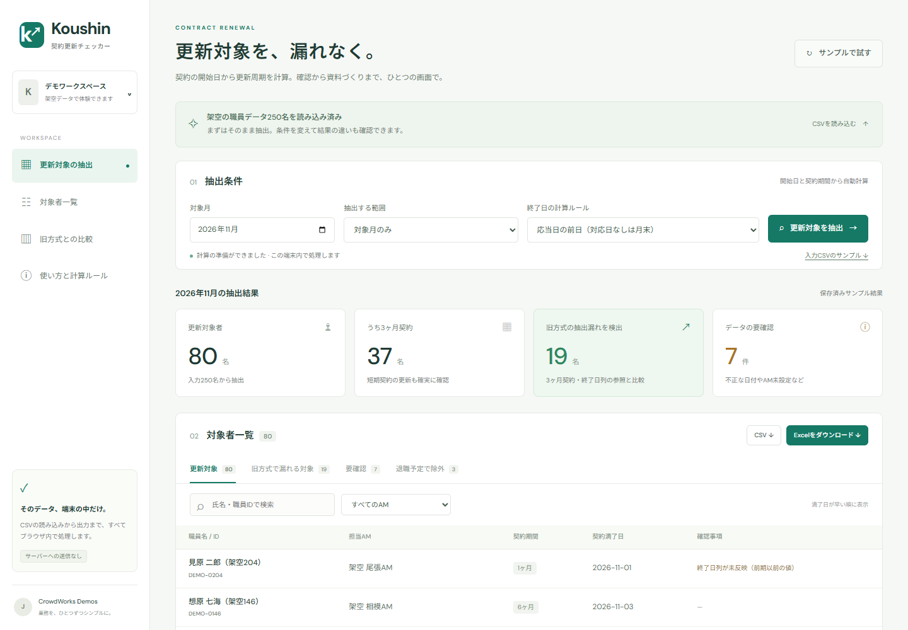

# Agentic Agency — AIがチームになり、仕事を形に

Grok Botを軸に、依頼・調査・分析・制作・品質確認・納品をつなぐ、AIネイティブな受託チームの構想です。仕事の価値を、検証できる成果物として届けることを目指します。

**紹介サイト：[Agentic Agency](https://koushin-checker-jun0908.vercel.app/)**

**操作デモ：[サンプル250名で試す](https://koushin-checker-jun0908.vercel.app/demo/)**

**追加の操作デモ：[請求書PDFの読み取り](https://koushin-checker-jun0908.vercel.app/invoices/) / [営業候補リストの整理](https://koushin-checker-jun0908.vercel.app/leads/)**

紹介サイトには相談を想定する領域、Botの役割分担、成果物の例、Skill再利用の構想を掲載しています。Botチームは設計として紹介しており、このリポジトリはGrok Bot連携や全工程の自動化の稼働証跡ではありません。

**Grok Botチームの実装仕様：[導入・設計パッケージ](docs/agentic-agency/README.md)**。司令塔から専門Botへ営業・調査・制作・QA・納品準備を割り振る構成、23種類の仕事、共有ファイル、Skill・Routine、APIの後付け手順を具体化しています。[Grok Botへ渡す最初の指示](docs/agentic-agency/START-HERE.md)から設定できます。Bot登録・稼働検証は未実施です。

制作物として、請求書の転記、営業候補の整理、契約更新対象者の抽出を自動化する3つの業務デモを収録しています。**ソースコード・サンプル入力・出力例・検証手順**を同梱しています。以下の操作説明と検証結果は、各制作物に対するものです。

3つともログイン不要で、サンプル入力を使って実際に処理・ダウンロードできます。契約更新は職員250名の抽出、請求書はPDFのテキスト読取・日本語OCRとExcel作成、営業リストは架空の検索結果26件の重複排除・分類に対応します。処理はブラウザ内で実行し、入力データをサーバーに送信しません。[Web版の構成・実行方法](web/README.md)

[](https://koushin-checker-jun0908.vercel.app/demo/)

特に契約更新デモでは、更新内容が未反映の終了日列に依存せず、当初の開始日と契約周期から対象者を計算します。架空データ250行・2026年11月の条件で、旧方式が見落とす3ヶ月契約者19名を抽出。境界値・閏年・データ不備を含む自動テストは **62件成功**しています。

## できることと確認できる成果

| デモ | 解決する業務課題 | 実装済みの処理・成果物 | 検証結果と根拠 |
|---|---|---|---|
| [契約更新対象者の抽出](3_契約更新抽出/README.md) | 終了日列の反映待ちや月末処理による抽出漏れ | 起算日からの周期計算、AM別Excel、対象者CSV、確認依頼文、データ不備一覧 | **62テスト成功**。250行から対象80名、うち3ヶ月契約37名を抽出。[テスト](3_契約更新抽出/tests/test_renewal.py)・[出力CSV](3_契約更新抽出/output/更新対象者_2026-11.csv) |
| [焼肉店の営業候補リスト](2_焼肉店営業リスト/README.md) | 検索結果の重複、対象外店舗の混入、炭火使用の判断根拠不足 | 8エリア対応、重複排除、エリア・業種・閉業の除外、根拠付き分類、CSV／Excel | モック26件 → 重複排除後18件 → 対象14件。除外4件の理由も保存。[集計JSON](2_焼肉店営業リスト/output/mock_leads_summary.json) |
| [請求書PDFの読み取り](1_請求書読み取り/README.md) | PDFからの支払情報の転記と期限確認 | テキスト抽出／日本語OCR、6項目の抽出、支払期日順Excel、要確認フラグ | 既存サンプル **28/30項目正解（93%）**、未見レイアウト **1/12項目正解（8%）**。[既存評価](1_請求書読み取り/output/accuracy_report.md)・[未見評価](1_請求書読み取り/output/accuracy_report_holdout.md) |

数値は同梱データに対する結果です。処理時間の削減率、実顧客での導入実績、本番データでの精度は未計測です。

## 実装で重視したこと

| 観点 | 実装内容 | 確認先 |
|---|---|---|
| 業務ルールの明確化 | 契約の終了日を3種類の規約で計算。旧方式3パターンとの比較を出力 | [renewal.py](3_契約更新抽出/renewal.py)・[比較処理](3_契約更新抽出/extract_renewals.py) |
| 境界値の検証 | 月末・閏年・1日開始・1/3/6/12ヶ月契約・期間の連続性・24ヶ月の周期を検証 | [test_renewal.py](3_契約更新抽出/tests/test_renewal.py) |
| 判断根拠の保存 | 営業候補に判定根拠と検索語を付与。除外店舗は理由付きで別出力 | [yakiniku_leads.py](2_焼肉店営業リスト/yakiniku_leads.py)・[除外CSV](2_焼肉店営業リスト/output/mock_leads_excluded.csv) |
| 不確実なデータの扱い | OCR行を要確認にし、契約データの不正日付・ID重複・AM未設定などを報告 | [請求書の抽出処理](1_請求書読み取り/extract_invoices.py)・[契約の抽出ルール](3_契約更新抽出/README.md#抽出ルール) |
| 成果物の使いやすさ | Excelの見出し固定・色分け・フィルタ。契約更新Excelには回答用プルダウンと印刷設定 | [請求書Excel](1_請求書読み取り/output/invoices.xlsx)・[営業候補Excel](2_焼肉店営業リスト/output/mock_leads.xlsx)・[契約更新Excel](3_契約更新抽出/output/更新対象者_2026-11.xlsx) |
| 再現性 | 架空入力、生成スクリプト、正解データ、モック応答、評価コマンドを同梱 | 各デモのREADMEと以下の実行手順 |

## クイックスタート：APIキーなしで検証する

確認環境は **Windows / Python 3.11.9** です。以下はリポジトリのルートから実行するPowerShell用コマンドです。macOS／Linuxでは `.venv/Scripts/python.exe` を `.venv/bin/python` に置き換えてください。

### 1. 環境を用意する

既にローカルにある場合は、cloneを省略してそのフォルダーで実行してください。非公開リポジトリのcloneにはアクセス権が必要です。

```powershell
git clone https://github.com/Jun0908/crowdworks-demos.git
cd crowdworks-demos
python -m venv .venv
.venv/Scripts/python.exe -m pip install -r "3_契約更新抽出/requirements.txt" requests
```

依存関係のインストール後、以下の検証は外部API・APIキーなしで実行できます。生成ファイルはGit管理対象外の `.demo-output/` に保存します。

### 2. 契約更新の自動テストと成果物を確認する

```powershell
.venv/Scripts/python.exe -m pytest -q "3_契約更新抽出/tests"
.venv/Scripts/python.exe -X utf8 "3_契約更新抽出/extract_renewals.py" --input "3_契約更新抽出/data/staff.csv" --month 2026-11 --out ".demo-output/renewals"
```

期待される結果：

- テスト：`62 passed`。
- 入力：250行。対象80名、退職予定による除外3名、データ要確認7件。
- 対象者の契約期間内訳：1ヶ月30名、3ヶ月37名、6ヶ月9名、12ヶ月4名。
- 出力：対象者Excel／CSV、確認依頼文13件。依頼文にはAM未設定の確認用グループも含みます。

**3ヶ月契約者の比較（2026年11月・既定規約 `civil`）**：

| 方式 | 抽出人数 | 周期ルール上の対象人数 | 漏れ | 誤抽出 |
|---|---:|---:|---:|---:|
| 本ツール：起算日から周期を計算 | 37 | 37 | 0 | 0 |
| 旧方式A：終了日列をそのまま参照 | 18 | 37 | 19 | 0 |
| 旧方式B：四半期末の一斉満了と仮定 | 0 | 37 | 37 | 0 |
| 旧方式C：開始月だけで周期を判定 | 36 | 37 | 12 | 11 |

比較の基準は、本デモで定義した周期ルールによる対象集合です。実契約に対する独立した正解ラベルとの照合結果ではありません。ルールの実装は、期待日付を指定したテストと周期・連続性のテストで確認しています。

### 3. 営業候補のモック処理を確認する

```powershell
.venv/Scripts/python.exe -X utf8 "2_焼肉店営業リスト/yakiniku_leads.py" --mock --out-dir ".demo-output/leads"
```

期待される結果は、入力26件、重複排除後18件、対象14件です。対象外エリア2件・閉業1件・業種不一致1件を除外し、対象を「確定7件／可能性2件／不明5件」に分類します。

出力は `mock_leads.csv`、`mock_leads.xlsx`、`mock_leads_excluded.csv`、`mock_leads_summary.json` です。「確定」は実装した文言ルールによる分類であり、実店舗への確認済みを意味しません。集計の `requests.searchText: 34` はモック呼び出し回数で、実APIへの通信は発生しません。

### 4. 請求書の保存済み抽出結果を再評価する

```powershell
.venv/Scripts/python.exe -X utf8 "1_請求書読み取り/evaluate.py" "1_請求書読み取り/output/extracted.json" "1_請求書読み取り/ground_truth.json"
.venv/Scripts/python.exe -X utf8 "1_請求書読み取り/evaluate.py" "1_請求書読み取り/output/extracted_holdout.json" "1_請求書読み取り/ground_truth_holdout.json"
```

評価単位は「PDF数 × 6項目（請求日・金額・取引先・振込先・支払期日・勘定科目）」です。振込先は銀行・支店・種別・口座番号・名義の一致をまとめて1項目としています。

| データセット | PDF数 | 正解 | 未取得 | 誤り | 項目単位の正解率 |
|---|---:|---:|---:|---:|---:|
| 既存サンプル | 5 | 28 | 0 | 2 | 93% |
| 未見レイアウト | 2 | 1 | 10 | 1 | 8% |

このコマンドは保存済みJSONと正解データの照合です。PDFから抽出を再実行するには、追加のPython依存関係とTesseract日本語OCR環境が必要です。[請求書デモのセットアップ](1_請求書読み取り/README.md#セットアップdebianubuntu)を参照してください。

## 適用範囲と本番化で必要な対応

| デモ | 現在の適用範囲 | 本番化前に必要な対応 |
|---|---|---|
| 契約更新 | 当初開始日から一定期間で更新する契約。対象抽出・確認資料の生成まで | 契約履歴・期間変更・再雇用・異動履歴の取り込み、実際の終了日規約との照合、回答回収・権限管理・操作ログの追加 |
| 営業候補 | モックでの処理検証とOSM実データの試行。Google Places API用コードを実装 | 利用するデータソースの保存・出力条件の確認、必要項目の充足確認、炭火使用の実態確認。実APIでの品質・網羅性は未検証 |
| 請求書 | 同梱帳票でのルールベース抽出と精度評価 | 未見帳票への対応、OCR誤認識・表記揺れへの改善、実帳票での追加評価。現状の未見精度では自動確定に使えず、原本照合が必要 |

契約デモ内の期限・無期転換関連フラグは簡略化した参考計算です。実際の契約条件に対する確認が必要です。メール送信、回答回収、リマインドの機能は含みません。

## データと検証の出所

- **請求書・職員CSV・店舗モック**：架空の検証用データです。生成スクリプトを各ディレクトリに同梱しています。
- **OSM試行結果**：実データです。[集計](2_焼肉店営業リスト/output/osm_trial_summary.json)には50件を記録していますが、瑞穂の取得失敗と電話・住所等の欠損を含み、完成済み営業リストとしての品質は確認していません。帰属：© OpenStreetMap contributors（ODbL）。
- **検証日：2026-10-11**。契約更新の62テストと抽出CLI、店舗モックCLI、請求書の保存済み結果の再評価を実行し、上記数値を確認しました。OCRの再実行と外部APIへの再取得は、このREADME更新時の検証には含みません。

## ディレクトリ

```text
crowdworks-demos/
├── README.md
├── 1_請求書読み取り/      # PDF抽出・OCR・正解データ・項目別評価
├── 2_焼肉店営業リスト/    # 検索・重複排除・分類・モック・OSM試行
└── 3_契約更新抽出/        # 周期計算・AM別資料・比較処理・62テスト
```

各ディレクトリのREADMEに、入力形式、CLIオプション、処理ルール、詳細な制約を記載しています。
