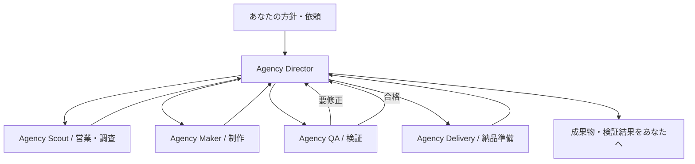

# Agentic Agency — Grok Bot内で動く受託チーム

実装仕様 v1 / 2026-10-11。実行環境は **Grok Bot内の司令塔Botと専門Bot**。[共有案件CLI](../../agency_runtime/README.md)と[Grok用Skill](grok-kit/agency-orchestrate/SKILL.md)を実装済み。Grokで5 Botを用意し、初回の調査・提案制作まで進んだ。その後、使用量上限で停止した。[稼働状況](runtime-status.md)と[再開指示](RESUME-IN-GROK.md)を参照する。

## プロダクト

ユーザーが会社の方針を伝えると、営業機会の発見、調査、企画、制作、検証、納品準備をBotチームが継続的に進める。今ある3つのツールは制作能力の一部。調査レポート、提案書、記事、資料、Webサイト、アプリ、データ処理などを同じ案件管理で扱う。

利用者の窓口は司令塔Botの会話。依頼・質問・確認・完成報告をここにまとめる。仕事一覧は共有ファイルから生成し、成果物は会話にも添付する。新しいWebバックエンド、独自のエージェントサーバー、xAI推論APIキーを開始条件にしない。

## チーム構成

| Bot名 | 担当 | 完了時に返すもの |
|---|---|---|
| Agency Director | 依頼受付、計画、割当、状態管理、再開、利用者との窓口 | 仕事一覧、進捗、完成報告、必要な判断 |
| Agency Scout | 営業機会発見、企業・市場・競合の調査 | 出典つき調査、候補一覧、適合理由 |
| Agency Maker | 提案書、記事、資料、データ処理、Web・アプリの制作 | 実ファイル、動く試作品、制作記録 |
| Agency QA | 要件・出典・形式・動作の確認 | PASS / REVISE / BLOCKEDと根拠 |
| Agency Delivery | ファイル整理、使い方、納品準備 | 成果物一式、説明、未確認事項 |

初期はDirectorから専門Botへ直接依頼し、完了はDirectorへ返す。全員が他の全員に割り振らない。実際のBot名はフウ＝Director、リサーチ担当＝Scout、コード担当＝Makerを再利用する。恒常ルールは [agent-instructions.md](agent-instructions.md)、CLIの操作手順は [grok-kit](grok-kit/agency-orchestrate/SKILL.md)。

## 基本フロー

仕事の入口は「自分からの依頼」「営業機会からの提案準備」「受注済み案件」「定期更新」。営業機会は受注・売上と区別する。外部送信は、宛先・本文・添付ファイルを揃えてDirectorとの個別会話で確認する。

## 仕事の種類

| 分野 | 仕事例 | 最初に必要なもの |
|---|---|---|
| 営業 | 候補探索、顧客調査、提案書、連絡文、商談準備 | 方針、公開情報、必要なら検索サービス |
| 調査・企画 | 市場調査、競合比較、要件定義、実施計画 | 調査テーマ、出典、完成条件 |
| 文章・資料 | 記事、FAQ、マニュアル、スライド | 元資料、読み手、出力形式、作成ツール |
| 開発 | 紹介サイト、LP、業務アプリ、試作品 | 要件、コード実行・検証環境、必要ならCloud Agent |
| データ処理 | 営業リスト、請求書、契約更新、CSV・Excel整理 | 入力データ、既存Python処理、必要な依存関係 |
| メディア | バナー、商品画像、説明動画 | 制作ツール／API、素材、予算 |
| 運営 | 定期レポート、CRM更新、納品、作業手順の改善 | 接続先、定期実行の方針、操作権限 |

23種類の入出力と依存機能を [capabilities.json](capabilities.json) に定義した。すべて「設定予定／接続確認待ち」であり、利用できるツールと試行結果を確認してから実行可能にする。

## 自動営業の初期ルール

1. 会社の方針に合う公開案件・企業情報を探す。1回最大5候補。
2. URLやソース固有IDで重複を除外する。募集情報と課題仮説を分ける。
3. 適合度を「業務一致40・依頼具体性30・制作可能性20・新しさ10」で評価し、各点の理由を保存する。受注確率とは呼ばない。
4. 上位3件まで詳細調査し、70点以上かつ実行可能な仕事のうち最大1件で提案準備を始める。
5. 必要なら小さな試作品を作り、QA後にあなたへ返す。
6. 定期実行は単発の完走後に設定する。候補がない場合は0件、検索失敗は失敗として残す。

## 後からAPIを接続する場所

Grok Bot自身の作業と、接続先サービスのAPIを分ける。通常のBot同士の引き継ぎにxAI APIキーは必要条件としない。検索、画像・動画、CRM、メール、デプロイ等で必要な接続を追加し、その仕事だけ有効にする。

具体的な接続設定、未設定時の扱い、共有環境での鍵管理は [connections.md](connections.md)。コードには認証情報を書かず、Grok Botの安全な入力・接続手順を利用する。

## 実装する順番

1. [Grok Botへ渡す最初の指示](START-HERE.md)をDirectorの会話へ送る。
2. 5 Botと共有作業フォルダーを作り、相互参照を確認する。
3. [引き継ぎ・保存・再開仕様](architecture.md)に沿って1件の仕事を完走する。
4. 成功した手順をSkillとして保存し、別の依頼で再利用を確認する。
5. [実装チェックリスト](implementation-backlog.md)で確認後、Routineを有効化する。

会社方針の初期値は [company-policy.example.json](company-policy.example.json)。営業探索は対象業種・検索条件を確定してから有効化する。空の条件で無制限に探索しない。依頼入力・計画・工程結果の形式は [contracts.schema.json](contracts.schema.json) に定義し、[example-job.json](example-job.json) を最初の試行に使う。

全資料を1ファイルにまとめた [GROK-SETUP.md](GROK-SETUP.md) も用意している。Grok Botへ添付する場合はこちらを使える。

## 完成の判定

- Directorへの1回の依頼から、専門Botへの引き継ぎと戻りが記録される。
- 入力→制作→QA→成果物まで実在するファイルで追跡できる。
- 中断後、保存済み状態を読み直して再開できる。作り直しや重複送信を避ける。
- 未接続のAPIが必要な仕事は接続待ち。他の独立した仕事は進められる。
- 作成したSkill、登録したRoutine、実行したBotを実名・リンクで記録する。
- サンプル、実調査、実制作、未実装を画面・報告で区別する。

既存の紹介サイトと3つのデモは公開済み。このBotチームは、本パッケージをGrok Botで適用・検証する段階にある。
